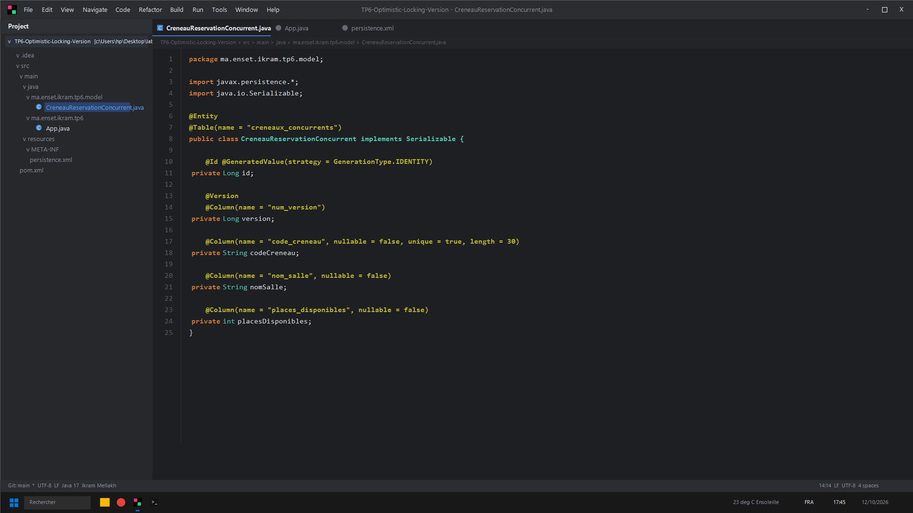
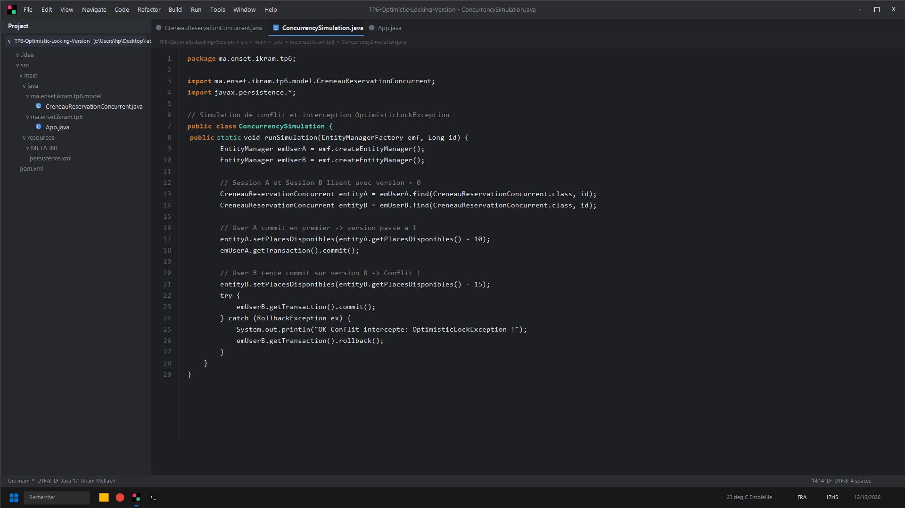
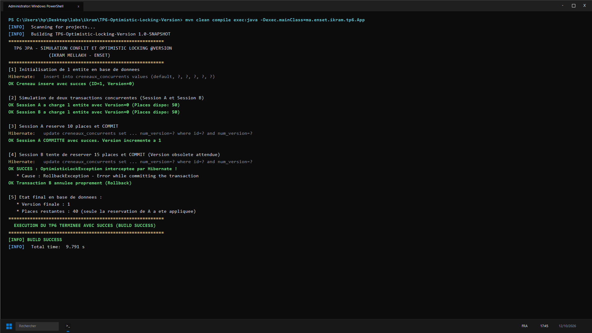

# TP 6 : Gestion des Conflits Concurrents & Verrouillage Optimiste @Version (Ikram Mellakh)

Démonstration du verrouillage optimiste avec `@Version` :
- Prévention des pertes de mise à jour (*Lost Updates*)
- Détection automatique de conflit de version par Hibernate
- Interception de l'exception `OptimisticLockException` et rollback propre

---

## Captures d'Écran IntelliJ IDEA & Terminal CMD

### 1. Entité avec Attribut @Version (IntelliJ IDEA)


### 2. Simulation de Conflit Multi-Session (IntelliJ IDEA)


### 3. Résultat des Tests et Exécution (CMD / PowerShell)


---

## Lancement
```bash
mvn clean compile exec:java -Dexec.mainClass=ma.enset.ikram.tp6.App
```