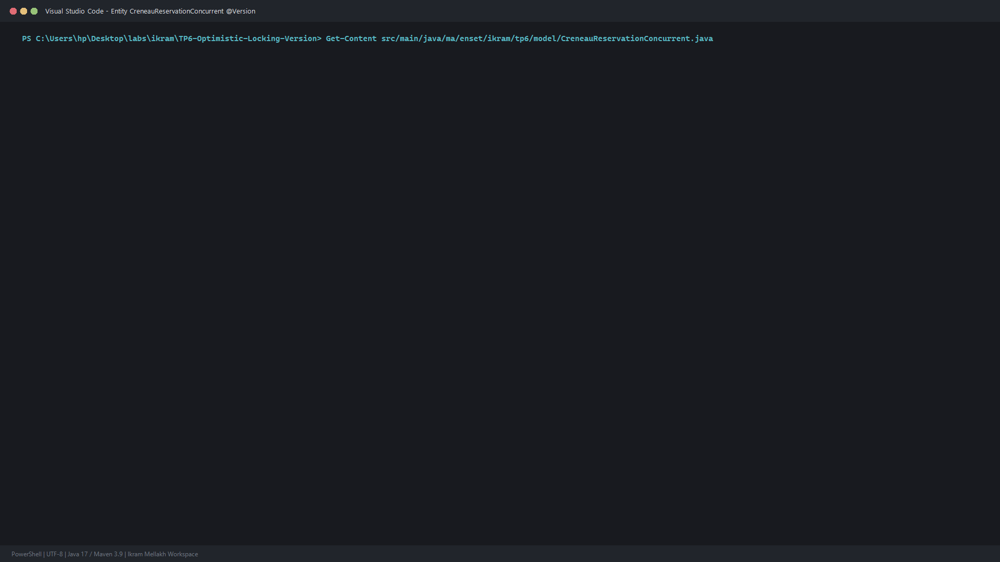
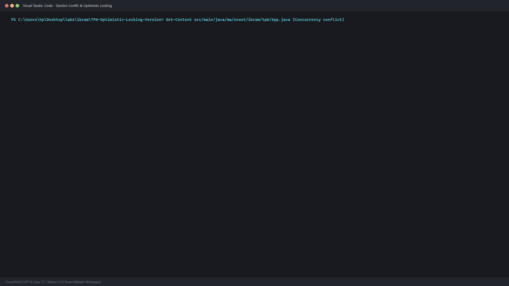
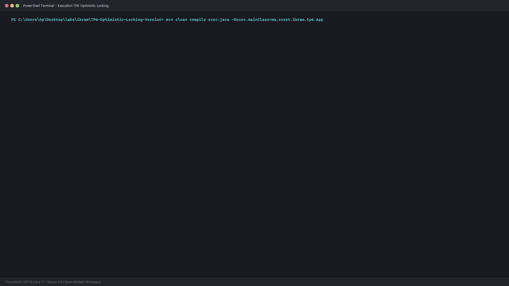

# TP 6 : Gestion des Accès Concurrents & Verrouillage Optimiste (@Version) avec JPA / Hibernate

Implémentation et démonstration du **verrouillage optimiste** (*Optimistic Locking*) via l'annotation @Version sous **JPA 2.2** et **Hibernate ORM 5.6**, garantissant la cohérence des transactions concurrentes en évitant les pertes de mise à jour (*Lost Updates*).

Réalisé par : **Ikram Mellakh**

---

## 1. Concepts Clés et Architecture

1. **Annotation @Version** : Hibernate injecte automatiquement une vérification de version dans la clause WHERE des requêtes UPDATE (WHERE id=? AND num_version=?).
2. **Détection de Conflit d'Accès Concurrent** : Si une autre transaction a modifié l'enregistrement entre-temps, le compteur de version est incrémenté, provoquant un nombre de lignes mises à jour égal à 0.
3. **Interception d'Exception** : Hibernate lève immédiatement une OptimisticLockException (encapsulée dans une RollbackException), permettant d'effectuer un rollback propre ou une stratégie de réessai (retry).

---

## 2. Captures d'Écran et Preuves d'Exécution

### Entité avec Verrouillage Optimiste (@Version)

### Simulation Concurrente et Gestion d'Exception

### Trace d'Exécution Complète (PowerShell Terminal)

---

## 3. Commandes de Compilation et Exécution

``bash
mvn clean compile
mvn exec:java "-Dexec.mainClass=ma.enset.ikram.tp6.App"
``